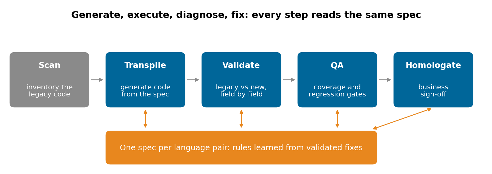
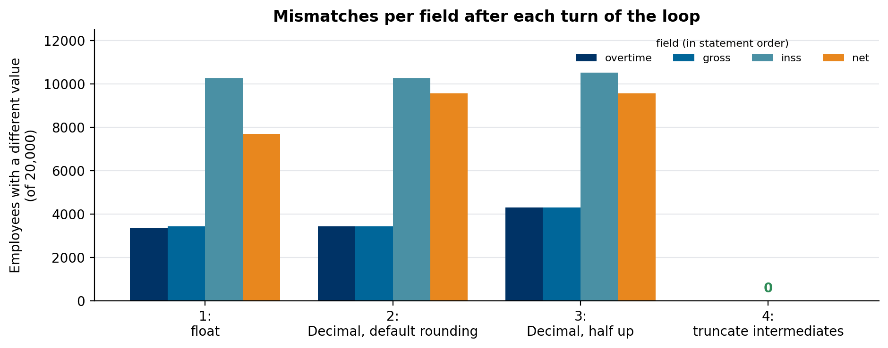

# Legacy migration validation loop

A COBOL payroll rule, its oracle and four turns of the translate-validate loop, showing why field-by-field comparison finds the bug the final output hides.

Companion code for the article **[Migrating legacy code with spec-driven AI](https://lucas.rangeltech.net/articles/h12-migrating-legacy-code-spec-driven/)**.

## The problem

A language model translates COBOL to Python in seconds. Proving the translation computes the same thing is the actual project.

This repository takes a four-statement COBOL payroll rule and 20,000 synthetic employees. `legacy()` reproduces COBOL arithmetic with Python's `decimal` module (fixed-point fields, truncation on store, `ROUNDED` as half up) and acts as the oracle; in a real migration the oracle is the legacy program's own output.

> All data in this repository is synthetic, generated by the scripts with a fixed seed, with the shape of a real client problem. No client data, names or code are included.

## What the code does

Each candidate is what the translation looks like after one turn of the loop, and each turn adds one rule to the spec for the COBOL to Python pair:

1. floats and `round()` at the end;
2. `Decimal`, quantized with Python's default rounding (half-even);
3. `Decimal`, half up everywhere;
4. truncate every intermediate result to its field's scale, `ROUNDED` only where the statement says so.

The validator compares every intermediate field (overtime, gross, INSS, net), not only the final one.

## Results

| Turn | Employees with a different net pay (of 20,000) |
|---|---:|
| 1: float | 7,701 |
| 2: Decimal, default rounding | 9,570 |
| 3: Decimal, half up | 9,559 |
| 4: truncate intermediates | 0 |

Turns 2 and 3 look like fixes and don't converge; the field comparison shows the first difference is already in the overtime line, which has no `ROUNDED`.





## Run it

Python 3.11 or later.

```bash
pip install -r requirements.txt
python payroll.py
python figures.py figures
```

## Files

| File | What it is |
|---|---|
| `payroll.py` | the oracle, the four candidates and the field-by-field validator; writes `results.json` |
| `figures.py` | the loop and mismatches per field |

## License

Apache 2.0. See [LICENSE](LICENSE).
